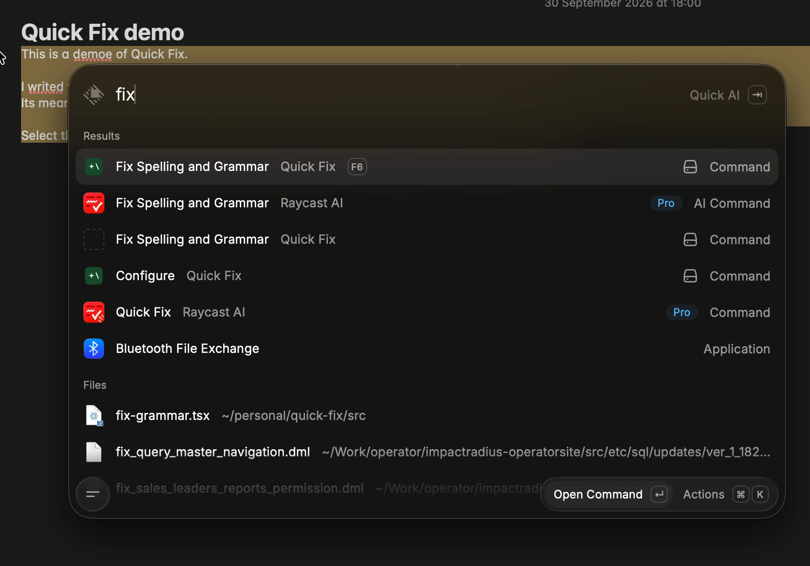
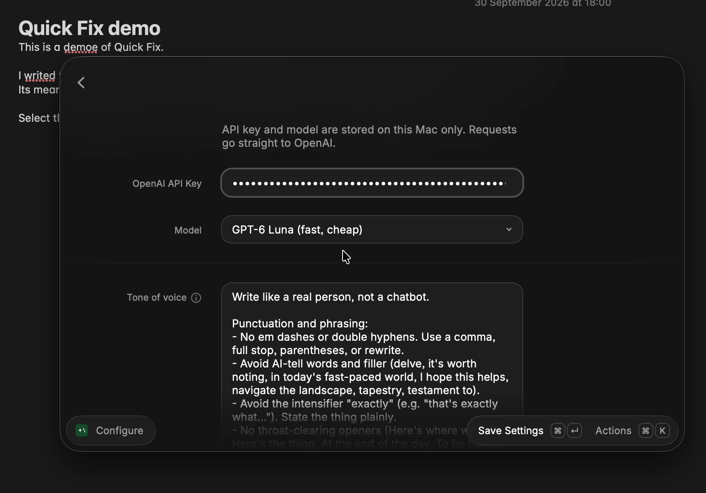
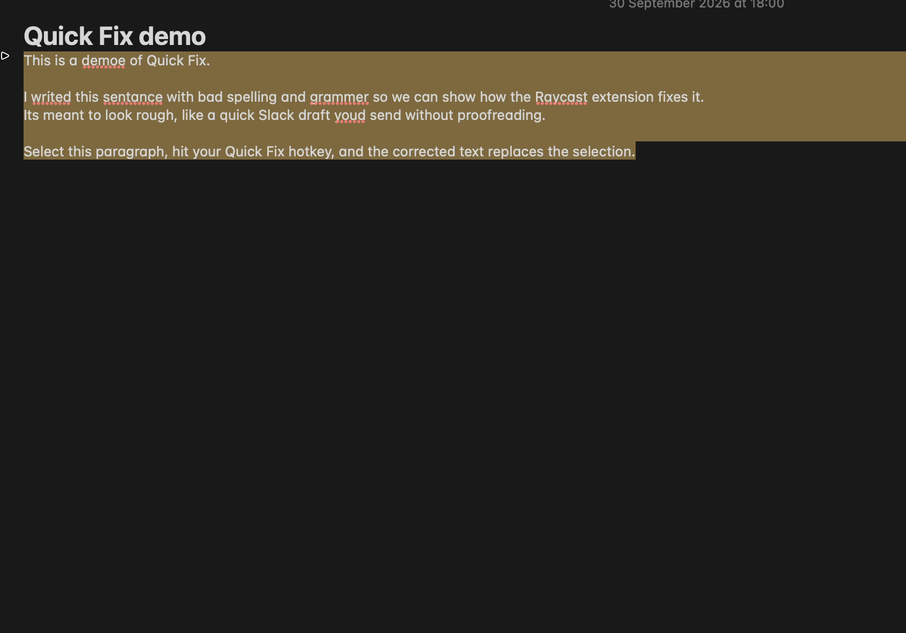
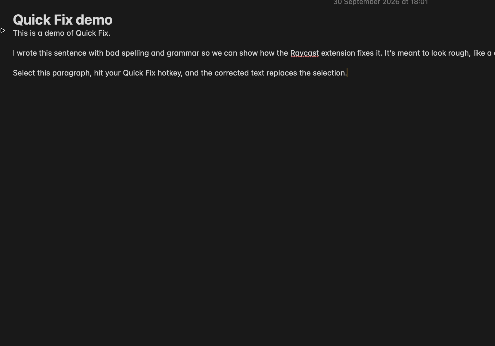

# Quick Fix

Raycast extension that fixes spelling and grammar on selected text — using **your own OpenAI or Cursor API key**, called directly from your Mac (not Raycast’s AI proxy).

[](docs/media/demo.mp4)

[▶ Watch demo (35s, ~750 KB)](docs/media/demo.mp4)

## What it can do

| | |
|---|---|
| Fix in place | Select text in any Mac app → run the command → corrected text replaces the selection |
| Backends | OpenAI or Cursor, picked in Configure. One key and one model are stored per backend, so switching never loses a key |
| Pick a model | OpenAI: GPT-6 Luna (default), Sol, GPT-5.6 Terra. Cursor: Claude Haiku 5.5 (default), GPT-5.6 Luna, Composer 2.5 |
| Tone of voice | Custom rules applied on every fix (anti–AI-tell defaults included) |
| Hotkey | Assign one in Raycast (e.g. F6) for a near–Quick Fix feel |

Not in scope (yet): rich-format preserve, before/after diff UI, backends beyond OpenAI and Cursor, Raycast Pro’s double-tap modifier.

## How it works

```
Any Mac app
   select text
        │
        ▼
Raycast hotkey / command
        │
        ├─ read selection (clipboard saved & restored)
        ├─ call the selected backend (OpenAI or Cursor) with your key
        │     system: copy-edit + your tone-of-voice rules
        └─ Clipboard.paste(corrected text)  →  replaces selection
```

1. **Selection** — `getSelectedText()`, with your previous clipboard restored afterward
2. **Prompt** — fixed copy-editor instructions plus your **Tone of voice** rules from Configure
3. **Replace** — result is pasted over the selection; HUD shows `Fixed`

### Cursor backend

Cursor has no plain chat-completions endpoint, so each fix starts a short-lived Cursor agent through `@cursor/sdk`. The agent runs in an empty temp folder with no repo access and no tools, so it can only reply with text. Expect about 6 seconds per fix, against 1-2 seconds for OpenAI. Most of that is agent setup, not the model. The SDK is bundled into the extension and only loaded when a Cursor fix runs.

Privacy: API key and settings live in Raycast `LocalStorage` on this Mac. Nothing is sent through Raycast’s servers.

## Screenshots

**Configure** — backend, API key, model, and tone of voice:



**Before** — draft with typos selected:



**Run the command** (search or hotkey):


**After** — selection replaced in place:



## Setup

1. `npm install`
2. Run `npm run dev` once so Raycast picks up the extension, stop it, then install a production build. Repeat the build after code changes:

   ```bash
   npx ray build -e dist -o ~/.config/raycast/extensions/quick-fix
   ```

3. Raycast → **Configure** → pick a backend, paste its API key (Cursor: Dashboard → Integrations), pick model, tweak tone → Save
4. Optional: Extensions → Quick Fix → **Fix Spelling and Grammar** → Record Hotkey

`npm install` also pre-bundles the Cursor SDK into `src/vendor/cursor-sdk.js` (`npm run bundle:sdk`), because Raycast's bundler can't build it directly.

Why not keep `npm run dev` running: its dev bundle includes source maps for the Cursor SDK, and Raycast kills it at its 100 MB memory limit.

Before publishing to the Raycast Store, set `"author"` in `package.json` to your Raycast username.

## Usage

1. Select text in any Mac app
2. Run **Fix Spelling and Grammar** (or your hotkey)
3. Corrected text replaces the selection

If nothing is selected, or the selected backend's API key is missing, you get a toast instead of a silent no-op.

### Configure

| Field | Notes |
|---|---|
| Backend | OpenAI or Cursor. The key label and model list follow the choice |
| API Key | One per backend, stored locally on this Mac |
| Model | Dropdown for the selected backend (OpenAI default `gpt-6-luna`, Cursor default `claude-haiku-5-5`) |
| Tone of voice | Rules applied on every fix; **Reset Writing Style** restores the built-in default |

## Docs

- [MVP plan](docs/plan-mvp.md)

## License

MIT
